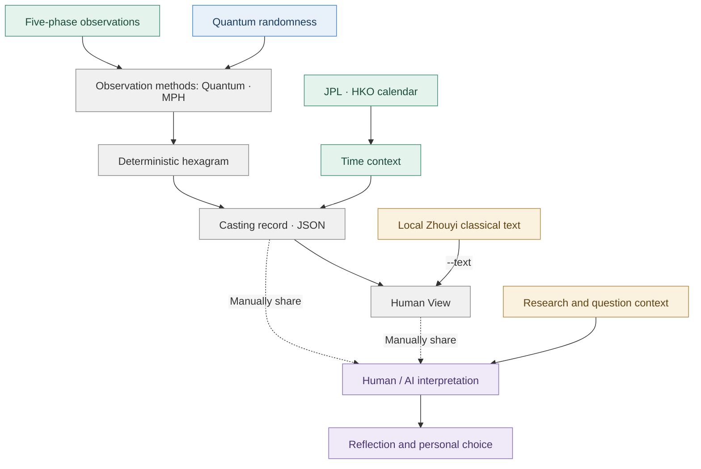

<p align="center">
  
</p>

<h1 align="center">Hexagram Casting</h1>

<p align="center">
  <a href="README.md"></a>
  <a href="README.zh-TW.md"></a>
</p>

<p align="center">
  <strong>觀象，察變，求真，思己。</strong>
</p>

<p align="center">
  Observe patterns. Discern change. Seek truth. Reflect within.
</p>

<p align="center">
  觀天地之變，探萬物之理，悟自身之道。
</p>

<p align="center">
  <em>Observe the changes of nature. Explore the principles of existence. Discover one's own path.</em>
</p>

<p align="center">
  <strong>Exploring change through nature, quantum randomness, and ancient wisdom.</strong>
</p>

<p align="center">
  透過天地萬象、量子隨機性與古老智慧，探索變化。
</p>

<p align="center">
  <strong>天地卦</strong> Physical &nbsp;·&nbsp; <strong>量子卦</strong> Quantum &nbsp;·&nbsp; <strong>萬象卦</strong> Myriad Phenomena
</p>

<p align="center">
  🌏 Nature &nbsp;·&nbsp; ⚛️ Quantum &nbsp;·&nbsp; 🔄 Change &nbsp;·&nbsp; 🔬 Science &nbsp;·&nbsp; 🪷 Wisdom
</p>

<p align="center">
  乾坤萬象化陰陽，<br>
  五行取象演玄章。<br>
  格物求真參易理，<br>
  觀時察變悟行藏。
</p>

---

The *I Ching* (易經) explores change through the language of yin and yang, the eight trigrams, and the sixty-four hexagrams. Casting a hexagram offers a symbolic starting point for reflecting on a question, a situation, or a moment of uncertainty.

This project brings together traditional hexagram casting, quantum randomness, astronomical and calendrical context, and the classical text of the *Zhouyi* (周易). It also explores how the structures and changes of the physical world might be represented through hexagrams.

It is a tool for **casting a hexagram (起卦)** and a space for exploring change, not a system that dictates how the hexagram should be interpreted.

> Nature reveals patterns.  
> Quantum randomness offers possibilities.  
> Hexagrams express change.  
> Classical wisdom invites reflection.  
> Interpretation belongs to the reader.

<p align="center">
  <strong>觀象，以知萬物。</strong><br>
  <strong>察變，以明其勢。</strong><br>
  <strong>求真，以辨其理。</strong><br>
  <strong>思己，以正其行。</strong>
</p>

<p align="center">
  <em>Observe patterns to understand the world.<br>
  Discern change to understand its direction.<br>
  Seek truth to distinguish underlying principles.<br>
  Reflect within to guide one's conduct.</em>
</p>

## Observation and Casting Methods

| Framework | Approach | Status |
| --- | --- | --- |
| **Physical**<br>天地卦 | Natural physical states, changes and relationships. | Experimental live casting; no QRNG |
| **Quantum**<br>量子卦 | Quantum randomness and the traditional three-coin method. | Implemented |
| **Myriad Phenomena**<br>萬象卦 | Five-phase observations combined with a quantum line. | Implemented |

Myriad phenomena (萬象) is the overarching observation concept. Physical observations and quantum randomness are constituent dimensions. All three methods are executable in one casting application. Physical uses an experimental native-label trend profile. The MPH mapping is an experimental symbolic model, not evidence of predictive validity or a scientific equivalence between the Five Phases and physical phenomena. See [Physical research #3](https://github.com/cctsao1008/trng-iching/issues/3), [MPH research #4](https://github.com/cctsao1008/trng-iching/issues/4), [implementation #5](https://github.com/cctsao1008/trng-iching/issues/5), and [Physical integration #6](https://github.com/cctsao1008/trng-iching/issues/6).

## ☯️ Yin, Yang and Change

| Line | Symbol |
| :--- | :---: |
| Yang 陽 |  |
| Yin 陰 |  |

Six lines, read from the bottom upward, form a hexagram. The lower and upper trigrams together express one of the sixty-four configurations of yin and yang.

The traditional three-coin method distinguishes four kinds of lines:

| Line | Nature | Meaning in casting |
| --- | --- | --- |
| 6 — 老陰 | Old yin | Yin changes to yang |
| 7 — 少陽 | Young yang | Yang remains |
| 8 — 少陰 | Young yin | Yin remains |
| 9 — 老陽 | Old yang | Yang changes to yin |

The **primary hexagram (本卦)** presents the original configuration. Moving lines (動爻) mark its changing elements. Their transformation produces the **relating hexagram (之卦)**.

The relationship between the two hexagrams opens a space for contemplating change. It does not, by itself, prescribe a particular future.

## 🕰️ The Moment of Casting

A hexagram is encountered at a particular moment, in the presence of a particular question.

The project records the time of casting alongside the solar term (節氣), lunar date (農曆), and four pillars (干支). Quantum uses the client receipt time of its random sample; MPH uses a common observation anchor before collecting the five domains. Calendrical context and classical passages do not change the formed hexagram.

A past casting record may preserve the lines and the time, but it cannot preserve the circumstances of that moment.

**Cast once, attend to the result, and leave the interpretation open.**

Choose the source before casting. Once the hexagram is formed, accept it as it is.

**Seek fidelity to the observed pattern, not a different hexagram.**

The same complete eligible input and fixed model produce the same lines, primary hexagram and relating hexagram. Different inputs may also map to the same hexagram. For Quantum and MPH, the complete input includes the quantum bits used by the selected method; repeated physical observations alone do not imply identical MPH casts.

All methods permit repeated observations and repeated hexagrams across independent casting processes. There is no cooldown, forced observation update, observation-epoch deduplication or automatic redraw. Required source quality, temporal support and freshness still apply. Within the same process, once a hexagram has formed, another must not form using the same casting time, even across methods. Unresolved attempts do not reserve a time; verification and rendering of existing or fixed reference inputs are not new live formations. The guard is process-local, not persistent.

Research windows may overlap; overlap must be disclosed and is not evidence of independent validation. Development/evaluation separation and frozen calibration requirements remain specific to each research protocol.

No casting record is stored unless the user explicitly requests it. There is no automatic archive, redraw, or selection of a preferred hexagram.

## 📖 The Classical Text

The *Zhouyi* offers the words through which generations have contemplated the hexagrams and their changes.

The local reference includes:

- 卦辭 — hexagram judgments
- 爻辭 — the statements of the six lines, including 用九 and 用六
- 彖傳 — commentary on the judgments
- 象傳 — images of the hexagrams and their lines
- 文言傳 — commentary on Qian and Kun

The human-readable display presents the primary judgment, the moving-line statements, and the relating judgment when different, with the special passage for Qian or Kun when applicable.

These passages are references, not compulsory rules for reading a hexagram. Different interpretive traditions, personal reflection, and AI-assisted study remain open to the reader.

The Chinese text comes from [Wikisource — Zhouyi](https://zh.wikisource.org/wiki/周易), with its source characters preserved. See [source revisions](data/sources.json) and [attribution and licensing](data/LICENSE.md). The transcription has been checked against captured source material. Known extraction CSS was removed from 32 ordinary lines; explicit inline variants are preserved separately from the base reading. Independent comparison of textual editions has not been performed.

##  Casting a Hexagram

Install Python dependencies:

```powershell
git clone https://github.com/cctsao1008/trng-iching.git
cd trng-iching
py -m pip install -r .\requirements.txt
```

Quantum is the default casting method. Choose one of the following sources, or select MPH explicitly.

**[TRNG.info](https://trng.info/) — default**

```powershell
py .\main.py cast --view human --text
```

**[LfD QRNG](https://lfdr.de/QRNG/) — alternative**

```powershell
py .\main.py cast --source lfdr.de --view human --text
```

Both quantum providers require no API key. A failed request stops the cast; the other provider is never selected automatically.

### Myriad Phenomena (MPH)

```powershell
py .\main.py cast --method mph --source lfdr.de --view human --text
```

The same JSON, Human View, classical text, audit and optional file-output interfaces are available. Omit `--view` for JSON. For the redacted acquisition diagnostic, use `--view summary` (a new cast) or `--audit` with the desired view (diagnostics on stderr). The default method remains Quantum. `--hex` and `--at` are Quantum-only.

MPH is integrated into the application; provider-use authorization is a separate unresolved release condition. Wood uses the official TWSE TAIEX Total Return Index and TAIFEX TX completed night-session observations without an API key. Night synthetic level = cash index × same-contract night last / regular last; the latest three completed scheduled observations feed R-Trend. Source: [TWSE](https://data.gov.tw/dataset/11871), [TAIFEX](https://data.gov.tw/dataset/11319). Provider-use review for the other domains and public release remains separate.

### An example

The following fixed reference cast illustrates 蒙之坤: 山水蒙 (Youthful Inexperience) changing into 坤為地 (The Receptive), with the second and sixth lines changing. It replays a previously observed sample without making a new quantum request.

```powershell
py .\main.py cast --hex df67c9 --at 2026-11-25T09:30:06+08:00 --view human --text
```

```text
Hexagram Casting
Source: user_provided_reference / df67c9
Mode: manual_reference_cast | Status: complete

Primary  04: 山水蒙
Relating 02: 坤為地

   PRIMARY            RELATING
6  ---------  *       ---- ----
5  ---- ----          ---- ----
4  ---- ----          ---- ----
3  ---- ----          ---- ----
2  ---------  *       ---- ----
1  ---- ----          ---- ----

* Line 2: Old Yang -> Yin
* Line 6: Old Yang -> Yin

Gregorian    : 2026-11-25 (Wednesday)
Lunar        : 丙午年十月十七
UTC Time     : 2026-11-25 01:30:06 (UTC+00:00)
Local Time   : 2026-11-25 09:30:06 (UTC+08:00)
Solar term   : 小雪
Four pillars : 丙午 己亥 癸卯 丁巳

Classical Text / 周易
本卦 04 蒙：亨。匪我求童蒙，童蒙求我。初筮告，再三瀆，瀆則不告。利貞。
九二：包蒙吉，納婦吉，子克家。
上九：擊蒙，不利為寇，利禦寇。
之卦 02 坤：元亨。利牝馬之貞。
君子有攸往，先迷後得主。
利西南得朋，東北喪朋。安貞，吉。
```

When no lines change, the human view displays only the primary hexagram. When lines change, it displays the primary and relating hexagrams side by side, marking the changing lines. The human view shows the Gregorian date, traditional Chinese lunar date (including leap months), UTC and local date/time, solar term and four pillars when available. The JSON retains the original numeric calendar fields and full timestamp precision. The terminal also displays the classical source links. This fixed example illustrates the output format; live casts are never selected or redrawn for a favorable result.

For an optional reading of this example in Traditional Chinese, English, or both languages, see [Reference Interpretation — Meng to Kun (蒙之坤)](https://github.com/cctsao1008/trng-iching/issues/1#issuecomment-7153460638). These readings are examples, not prescribed interpretations.

### Output options

Choose one of the following live commands (Quantum by default; add `--method mph` for mixed observations):

| Command (after `py .\main.py`) | Display | Recommended use |
| --- | --- | --- |
| `cast` | JSON for AI or other software | Asking through the hexagram with ChatGPT or another AI assistant |
| `cast --audit` | Full JSON with source and calculation details | Reviewing randomness provenance and casting calculations |
| `cast --view human` | Hexagrams | Quickly viewing the primary and relating hexagrams |
| `cast --view human --text` | Hexagrams and classical passages | Personal reflection and traditional interpretation |
| `cast --audit --view human --text` | Full JSON followed by hexagrams and classical passages | In-depth AI-assisted interpretation with classical references and full provenance |

Add `--source trng.info` or `--source lfdr.de` to any of these live commands to choose the randomness source explicitly. If omitted, TRNG.info is used.

Each live command attempts one cast; its hexagram need not differ from previous results. Confirm that the result is complete before using it; do not redraw to bypass a failure. `--view summary` is an MPH-only diagnostic and cannot be combined with audit or file output.

File output is optional: add `--json-out <new-file>` if desired. Existing files are not overwritten. If Human View rendering fails after a cast is formed, the existing JSON is exposed on stdout and the error is reported on stderr; no new cast is made. An explicitly saved record can be displayed with `py .\main.py view --input cast.json --text` without casting again.

## 🔬 Modern Foundations

Modern tools support the traditional practice without claiming to explain or validate its metaphysical meaning.

**Quantum randomness.** [TRNG.info](https://trng.info/) (default) or [LfD QRNG](https://lfdr.de/QRNG/) supplies one physical random sample per live cast. Both providers describe their entropy source as quantum optical hardware. The user selects one provider before casting; their samples are never combined. Eighteen bits from the three-byte sample are divided into six groups of three, reproducing the probabilities of the three-coin method. Quantum uses all six groups; MPH uses only the sixth group, after the five observation domains pass validation. No pseudorandom fallback or automatic retry is used.

**Mixed observations (MPH).** The six lines, bottom to top, are Metal (NOAA solar-wind magnetic field magnitude), Wood (TWSE total-return index and TAIFEX TX completed-night composite), Water (NOAA observed water level), Fire (NOAA proton thermal pressure), Earth (JPL Sun/Moon radial differential acceleration at the fixed model site), and Quantum. Each of the first five lines uses three exact observations on its native time grid or scheduled completed cash/night market observations. The signs of the two consecutive differences map to 6, 7, 8 or 9: (-,+), (+,+), (-,-), (+,-), respectively. A zero difference or invalid endpoint stops casting; no interpolation, alternative source or redraw is used. A single QRNG request follows successful five-domain validation. Source labels, observation epochs and client receipt times do not establish publication finality or hardware generation time.

**Astronomy and calendrics.** [NASA JPL DE440s](https://ssd.jpl.nasa.gov/) and [Skyfield](https://rhodesmill.org/skyfield/) provide astronomical calculations. The [Hong Kong Observatory](https://www.hko.gov.hk/en/gts/time/conversion1_text.htm) provides the lunar calendar reference. The local month-start index contains all 200 official Gregorian year tables from 1901 through 2100, with 2,474 lunar month starts and 73 leap months. Offline lunar date lookup supports 1901-01-20 through 2100-12-31 inclusive (UTC+08 civil dates); 1901-01-01 through 1901-01-19 are not supported because the preceding lunar month start falls outside the index. The four pillars use Li Chun, the twelve solar Jie, and civil time UTC+08, with the day boundary at midnight and no true-solar-time adjustment. Quantum uses the client's receipt of the random sample, not the unreported hardware measurement time. MPH uses its common observation anchor for the reference context, sharing the local pinned ephemeris session with the Earth observation calculation.

**Transparent results.** JSON schema 0.4.0 records the random input, six lines, hexagrams, and time context. The optional audit output adds calculation and source details. The question is never sent to the randomness provider. MPH adds selected-endpoint evidence and the top-line quantum scope. Local classical text and calendrical references do not determine the lines. Source-use review and release readiness remain separate from a successful cast; selected evidence does not authenticate original provider responses or full history.

The scientific tools describe randomness and time; they do not establish the predictive validity of divination.

## No-hexagram outcomes

A question does not require a hexagram. Insufficient or indeterminate observations under the fixed MPH model yield `unresolved` (exit 3); execution, configuration or model-readiness failures yield `error` (exit 1). Human View explains that no hexagram was formed and why. JSON and MPH summary mode emit a separate `cast-outcome-v1` envelope with `hexagram_formed: false` and reason codes, never a fabricated v0.4.0 cast. No cast file is written by `--json-out` and no classical text is shown for these outcomes. Detailed MPH diagnostics remain available with `--debug` or `--audit`. Existing formed cast format and selection rules are unchanged. A live Quantum acquisition or conversion failure also reports `error`; invalid CLI arguments and post-assembly failures retain existing handling. A no-hexagram outcome does not imply good or bad fortune.

## Debugging

Use `--debug` with any subcommand to enable redacted project diagnostics on stderr. For example:

```powershell
py .\main.py cast --method mph --view human --debug
py .\main.py cast --method mph --view human --debug 2> debug.log
```

Debug logs show execution stages, transport timing/status, active observation counts, exact required/missing timestamp labels and sanitized exception frame locations. They do not include raw entropy, observed values, line values, API URLs or exception text. Normal result output, saved records and selection rules are unchanged. Debug differs from `--audit` (cast provenance) and MPH `--view summary` (redacted result summary); it does not enable retries or change observation eligibility.

## ⚙️ System Architecture

One application combines observation, deterministic line conversion, shared hexagram assembly, reference context and presentation. Quantum and MPH use the same engine. Physical uses six natural sources without QRNG: `py .\main.py cast --method physical --view human --text`. Three fixed UTC 30-minute native-label bins end at the half-hour boundary at least 30 minutes before the request. Complete eligible labels and two nonzero changes per domain are required; incomplete observations return no hexagram (exit 3). The bottom-to-top order is water level, modeled tidal gravity, ground magnetic field (INTERMAGNET/BGS native BOUF, one-minute USGS observations), neutron rate, solar-wind thermal pressure and solar-wind magnetic magnitude. No fallback, redraw or calibrated uncertainty claim. Physical rejects `--source`, `--hex`, and `--at`. Experimental noncommercial research only.



<p align="center">
  
</p>

### Design Principles

> Nature reveals patterns.  
> Quantum randomness offers possibilities.  
> Hexagrams express change.  
> Classical wisdom invites reflection.  
> Interpretation belongs to the reader.

In Quantum, astronomical and calendrical context describes the moment without influencing the hexagram. MPH uses physical and market observations plus quantum randomness to form lines; its reference context remains separate. The casting record provides structured JSON; Human View renders that record and optionally retrieves passages from the local Zhouyi corpus. The reader may manually share either representation with an external AI assistant. Additional scholarly references and the question inform interpretation outside the casting application. The architecture supports reflection without asserting a predictive mechanism.

### Software Components

| Module | Responsibility |
| --- | --- |
| `main.py` | CLI, method dispatch, validation, casting coordination and JSON output |
| `sources.py` | Shared HTTP transport, source contracts, external observations and QRNG |
| `iching.py` | Pure quantum/trend line conversion and common hexagram assembly |
| `astronomy.py` | Pinned JPL session, Earth observation model and astronomical context |
| `lunisolar.py` | Look up lunar dates and calculate the four pillars |
| `human_view.py` | Method-aware saved-record validation, hexagram display and optional classical passages |
| `data/` | Local ephemeris, lunar calendar and Zhouyi references |

### 🧠 Asking through the hexagram (依卦問事)

Cast once, then, where the applicable source-use terms permit sharing, provide the resulting JSON to an AI assistant such as ChatGPT and ask your question. The assistant can interpret the hexagram in the context of the question, the classical text and present circumstances. The optional human view provides the relevant classical passages for reference.

Interpretation takes place outside the application. No AI connection, fixed mapping between hexagrams and modern events, or automatic judgment is built into the casting tool.

For additional technical options, use `py .\main.py --help` or `py .\main.py cast --help`.
