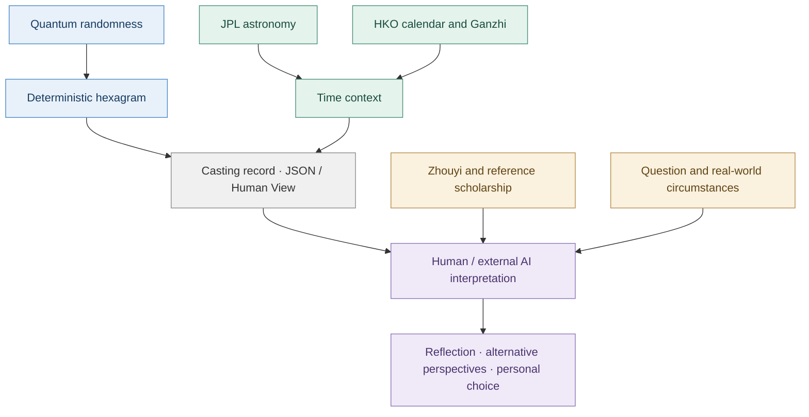

<p align="center">
  
</p>

<h1 align="center">TRNG Hexagram Casting</h1>

<p align="center">
  <strong>問天，觀象，思己。</strong>
</p>

<p align="center">
  Ask the universe. Observe the changes. Reflect within.
</p>

<p align="center">
  不為預知未來，而為洞察當下。
</p>

<p align="center">
  <em>Not to predict the future, but to understand the present.</em>
</p>

<p align="center">
  <strong>An ancient way of asking, with modern tools for casting.</strong>
</p>

<p align="center">
  ⚛️ Quantum &nbsp;·&nbsp; 🔄 Change &nbsp;·&nbsp; 🌏 Cosmos &nbsp;·&nbsp; 🪷 Wisdom
</p>

<p align="center">
  問天量子生爻象，<br>
  觀象乾坤察四方。<br>
  一卷周經參世理，<br>
  反觀吾己悟行藏。
</p>

---

The *I Ching* (易經) explores change through the language of yin and yang, the eight trigrams, and the sixty-four hexagrams. Casting a hexagram offers a symbolic starting point for reflecting on a question, a situation, or a moment of uncertainty.

This project brings together traditional hexagram casting, quantum randomness, astronomical and calendrical context, and the classical text of the *Zhouyi* (周易).

It is a tool for **casting a hexagram (起卦)**, not a system that dictates how the hexagram should be interpreted.

> Randomness determines the hexagram.  
> Heaven and the calendar describe the moment.  
> Classical text offers a language for reflection.  
> Interpretation belongs to the reader.

## ☯️ Yin, Yang and Change

| Line | Symbol |
| :--- | :---: |
| Yang 陽 |  |
| Yin 陰 |  |

Six lines, read from the bottom upward, form a hexagram. The lower and upper trigrams together express one of the sixty-four configurations of yin and yang.

The traditional three-coin method distinguishes four kinds of lines:

| Line | Nature | Meaning in casting |
| --- | --- | --- |
| 6 — 老陰 | Old yin | Yin changes to yang |
| 7 — 少陽 | Young yang | Yang remains |
| 8 — 少陰 | Young yin | Yin remains |
| 9 — 老陽 | Old yang | Yang changes to yin |

The **primary hexagram (本卦)** presents the original configuration. Moving lines (動爻) mark its changing elements. Their transformation produces the **relating hexagram (之卦)**.

The relationship between the two hexagrams opens a space for contemplating change. It does not, by itself, prescribe a particular future.

## 🕰️ The Moment of Casting

A hexagram is encountered at a particular moment, in the presence of a particular question.

The project records the time of casting alongside the solar term (節氣), lunar date (農曆), and four pillars (干支). These provide calendrical and astronomical context without changing the hexagram drawn.

A past casting record may preserve the lines and the time, but it cannot preserve the circumstances of that moment.

**Cast once, attend to the result, and leave the interpretation open.**

Choose the source before casting. Once the hexagram is formed, accept it as it is.

No casting record is stored unless the user explicitly requests it. There is no automatic archive, redraw, or selection of a preferred hexagram.

## 📖 The Classical Text

The *Zhouyi* offers the words through which generations have contemplated the hexagrams and their changes.

The local reference includes:

- 卦辭 — hexagram judgments
- 爻辭 — the statements of the six lines, including 用九 and 用六
- 彖傳 — commentary on the judgments
- 象傳 — images of the hexagrams and their lines
- 文言傳 — commentary on Qian and Kun

The human-readable display presents the primary judgment, the moving-line statements, and the relating judgment when different, with the special passage for Qian or Kun when applicable.

These passages are references, not compulsory rules for reading a hexagram. Different interpretive traditions, personal reflection, and AI-assisted study remain open to the reader.

The Chinese text comes from [Wikisource — Zhouyi](https://zh.wikisource.org/wiki/周易), with its source characters preserved. See [source revisions](data/sources.json) and [attribution and licensing](data/LICENSE.md). The transcription has been checked against captured source material; independent comparison of textual editions has not been performed.

##  Casting a Hexagram

Install Python dependencies:

```powershell
git clone https://github.com/cctsao1008/trng-iching.git
cd trng-iching
py -m pip install -r .\requirements.txt
```

When ready, choose one of the following sources and cast once.

**[TRNG.info](https://trng.info/) — default**

```powershell
py .\main.py cast --view human --text
```

**[LfD QRNG](https://lfdr.de/QRNG/) — alternative**

```powershell
py .\main.py cast --source lfdr.de --view human --text
```

Both sources require no API key. A failed request stops the cast; the other provider is never selected automatically.

### An example

The following fixed reference cast illustrates 蒙之坤: 山水蒙 (Youthful Inexperience) changing into 坤為地 (The Receptive), with the second and sixth lines changing. It replays a previously observed sample without making a new quantum request.

```powershell
py .\main.py cast --hex df67c9 --at 2026-11-25T09:30:06+08:00 --view human --text
```

```text
Hexagram Casting
Source: user_provided_reference / df67c9
Mode: manual_reference_cast | Status: complete

Primary  04: 山水蒙
Relating 02: 坤為地

   PRIMARY            RELATING
6  ---------  *       ---- ----
5  ---- ----          ---- ----
4  ---- ----          ---- ----
3  ---- ----          ---- ----
2  ---------  *       ---- ----
1  ---- ----          ---- ----

* Line 2: Old Yang -> Yin
* Line 6: Old Yang -> Yin

Gregorian    : 2026-11-25 (Wednesday)
Lunar        : 丙午年十月十七
UTC Time     : 01:30:06 (UTC+00:00)
Local Time   : 09:30:06 (UTC+08:00)
Solar term   : 小雪
Four pillars : 丙午 己亥 癸卯 丁巳

Classical Text / 周易
本卦 04 蒙：亨。匪我求童蒙，童蒙求我。初筮告，再三瀆，瀆則不告。利貞。
九二：包蒙吉，納婦吉，子克家。
上九：擊蒙，不利為寇，利禦寇。
之卦 02 坤：元亨。利牝馬之貞。
君子有攸往，先迷後得主。
利西南得朋，東北喪朋。安貞，吉。
```

When no lines change, the human view displays only the primary hexagram. When lines change, it displays the primary and relating hexagrams side by side, marking the changing lines. The human view shows the Gregorian date, traditional Chinese lunar date (including leap months), UTC and local time, solar term and four pillars when available. The JSON retains the original numeric calendar fields and full timestamp precision. The terminal also displays the classical source links. This fixed example illustrates the output format; live casts are never selected or redrawn for a favorable result.

For an optional reading of this example in Traditional Chinese, English, or both languages, see [Reference Interpretation — Meng to Kun (蒙之坤)](https://github.com/cctsao1008/trng-iching/issues/1#issuecomment-7153460638). These readings are examples, not prescribed interpretations.

### Output options

Choose one of the following live commands:

| Command (after `py .\main.py`) | Display | Recommended use |
| --- | --- | --- |
| `cast` | JSON for AI or other software | Asking through the hexagram with ChatGPT or another AI assistant |
| `cast --audit` | Full JSON with source and calculation details | Reviewing randomness provenance and casting calculations |
| `cast --view human` | Hexagrams | Quickly viewing the primary and relating hexagrams |
| `cast --view human --text` | Hexagrams and classical passages | Personal reflection and traditional interpretation |
| `cast --audit --view human --text` | Full JSON followed by hexagrams and classical passages | In-depth AI-assisted interpretation with classical references and full provenance |

Add `--source trng.info` or `--source lfdr.de` to any of these live commands to choose the randomness source explicitly. If omitted, TRNG.info is used.

Each live command casts a new hexagram. Confirm that the result is complete before using it; do not redraw to bypass a failure.

File output is optional: add `--json-out <new-file>` if desired. Existing files are not overwritten. An explicitly saved record can be displayed with `py .\main.py view --input cast.json --text` without casting again.

## 🔬 Modern Foundations

Modern tools support the traditional practice without claiming to explain or validate its metaphysical meaning.

**Quantum randomness.** [TRNG.info](https://trng.info/) (default) or [LfD QRNG](https://lfdr.de/QRNG/) supplies one physical random sample per live cast. Both providers describe their entropy source as quantum optical hardware. The user selects one provider before casting; their samples are never combined. Eighteen bits from the three-byte sample are divided into six groups of three, reproducing the probabilities of the three-coin method. The result is converted deterministically into six lines and King Wen hexagram numbers. No pseudorandom fallback or automatic retry is used.

**Astronomy and calendrics.** [NASA JPL DE440s](https://ssd.jpl.nasa.gov/) and [Skyfield](https://rhodesmill.org/skyfield/) provide astronomical calculations. The [Hong Kong Observatory](https://www.hko.gov.hk/en/gts/time/conversion1_text.htm) provides the lunar calendar reference. The four pillars use Li Chun, the twelve solar Jie, and civil time UTC+08, with the day boundary at midnight and no true-solar-time adjustment. The casting time is the client's receipt of the random sample, not the unreported hardware measurement time.

**Transparent results.** JSON schema 0.4.0 records the random input, six lines, hexagrams, and time context. The optional audit output adds calculation and source details. The question is never sent to the randomness provider. Local classical text and time references do not determine the random result.

The scientific tools describe randomness and time; they do not establish the predictive validity of divination.

## ⚙️ System Architecture

The system brings together quantum randomness, astronomical and calendrical context, classical text, and human reflection, while keeping their responsibilities distinct.



### Design Principles

> Randomness determines the hexagram.  
> Heaven and the calendar describe the moment.  
> Classical text offers a language for reflection.  
> Interpretation belongs to the reader.

Astronomical and calendrical data describe the moment of casting without influencing the hexagram. Classical references and the question inform interpretation, which takes place outside the casting application. The architecture supports reflection without asserting a predictive mechanism.

### Software Components

| Module | Responsibility |
| --- | --- |
| `main.py` | CLI, casting coordination and JSON output |
| `sources.py` | Acquire one three-byte quantum random sample from the selected provider |
| `iching.py` | Derive the six lines, moving lines and hexagrams |
| `astronomy.py` | Calculate celestial positions and solar terms using local JPL data |
| `lunisolar.py` | Look up lunar dates and calculate the four pillars |
| `human_view.py` | Render hexagrams and optionally retrieve classical passages |
| `data/` | Local ephemeris, lunar calendar and Zhouyi references |

### 🧠 Asking through the hexagram (依卦問事)

Cast once, then share the resulting JSON with an AI assistant such as ChatGPT and ask your question. The assistant can interpret the hexagram in the context of the question, the classical text and present circumstances. The optional human view provides the relevant classical passages for reference.

Interpretation takes place outside the application. No AI connection, fixed mapping between hexagrams and modern events, or automatic judgment is built into the casting tool.

For additional technical options, use `py .\main.py --help` or `py .\main.py cast --help`.
