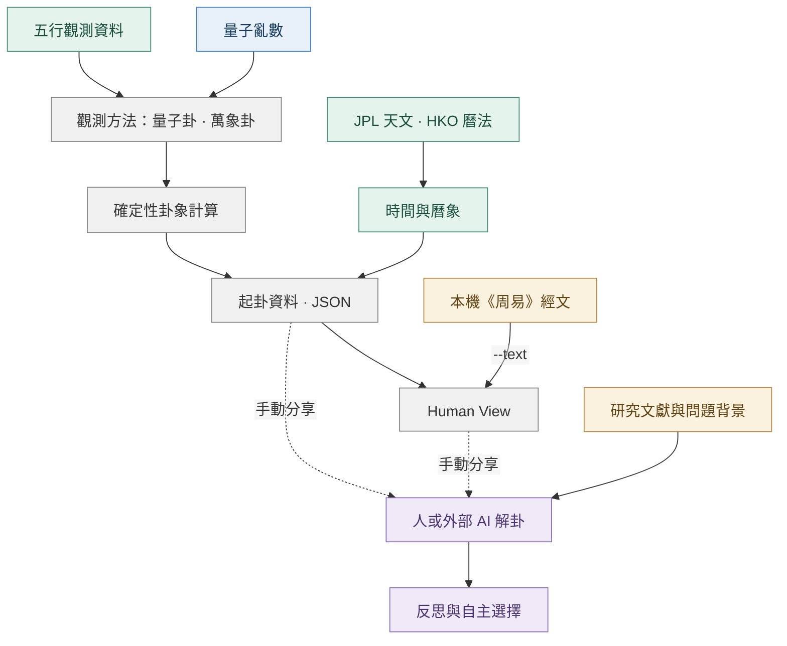

<p align="center">
  
</p>

<h1 align="center">Hexagram Casting</h1>

<p align="center">
  <a href="README.md"></a>
  <a href="README.zh-TW.md"></a>
</p>

<p align="center">
  <strong>觀象，察變，求真，思己。</strong>
</p>

<p align="center">
  Observe patterns. Discern change. Seek truth. Reflect within.
</p>

<p align="center">
  觀天地之變，探萬物之理，悟自身之道。
</p>

<p align="center">
  <em>Observe the changes of nature. Explore the principles of existence. Discover one's own path.</em>
</p>

<p align="center">
  <strong>Exploring change through nature, quantum randomness, and ancient wisdom.</strong>
</p>

<p align="center">
  透過天地萬象、量子隨機性與古老智慧，探索變化。
</p>

<p align="center">
  <strong>天地卦</strong> Physical &nbsp;·&nbsp; <strong>量子卦</strong> Quantum &nbsp;·&nbsp; <strong>萬象卦</strong> Myriad Phenomena
</p>

<p align="center">
  🌏 天地 &nbsp;·&nbsp; ⚛️ 量子 &nbsp;·&nbsp; 🔄 變化 &nbsp;·&nbsp; 🔬 科學 &nbsp;·&nbsp; 🪷 智慧
</p>

<p align="center">
  乾坤萬象化陰陽，<br>
  五行取象演玄章。<br>
  格物求真參易理，<br>
  觀時察變悟行藏。
</p>

---

《易經》透過陰陽、八卦與六十四卦的象徵語言，探索萬事萬物的變化。起卦提供一個象徵性的起點，讓人重新思考一個問題、一種處境，或某個尚未明朗的時刻。

本專案結合傳統起卦方法、量子亂數、天文曆象及《周易》經文，並探索如何透過卦象表達物理世界的資訊結構與變化。

這是一個**起卦工具**，也是探索變化的研究空間，而不是規定如何解卦的系統。

> 天地呈現萬象。  
> 量子開展可能。  
> 卦象表達變化。  
> 經典引領反思。  
> 解讀權屬於讀者。

## 觀測與起卦方法

| 框架 | 方法 | 狀態 |
| --- | --- | --- |
| **天地卦**<br>Physical | 自然物理現象的狀態、變化與關係。 | 研究中 |
| **量子卦**<br>Quantum | 量子真亂數與傳統三銅錢法。 | 已實作 |
| **萬象卦**<br>Myriad Phenomena | 五行資訊觀測結合量子爻。 | 已實作 |

萬象是整體的觀測概念，天地物理現象與量子隨機性是其中的觀測維度。量子卦與萬象卦是同一套起卦程式中的可選方法；獨立的天地卦六爻模型仍在研究中。萬象卦採用固定的實驗性象徵映射，不宣稱具有預測能力，也不預設五行與物理現象存在科學上的等價關係。詳見[天地研究 #3](https://github.com/cctsao1008/trng-iching/issues/3)、[萬象研究 #4](https://github.com/cctsao1008/trng-iching/issues/4)與[程式整合 #5](https://github.com/cctsao1008/trng-iching/issues/5)。

## ☯️ 陰陽與變化

| 爻 | 符號 |
| :--- | :---: |
| 陽爻 |  |
| 陰爻 |  |

六爻由下而上排列而成一卦，上下兩個三爻卦共同構成陰陽的六十四種組合之一。

傳統三銅錢法區分四種爻態：

| 爻值 | 性質 | 起卦意義 |
| --- | --- | --- |
| 6 — 老陰 | Old yin | 陰變陽 |
| 7 — 少陽 | Young yang | 陽不變 |
| 8 — 少陰 | Young yin | 陰不變 |
| 9 — 老陽 | Old yang | 陽變陰 |

**本卦（Primary Hexagram）**呈現原始卦象，動爻標示其中發生變化的部分。動爻轉換後形成**之卦（Relating Hexagram）**。

兩卦之間的關係提供觀察變化的空間，但並不必然預示特定的未來。

## 🕰️ 起卦的時刻

每一卦都形成於特定的時刻，伴隨著當下所思考的問題。

本專案記錄起卦時間、節氣、農曆日期及四柱干支。量子卦使用客戶端收到亂數的時間；萬象卦則使用取得五行觀測資料前確立的共同時間錨點。曆法背景與經文不改變已形成的卦象。

過去的起卦紀錄可以保留六爻與時間，卻無法完整保留當時的處境。

**一事一卦，觀其所得，解讀不設限。**

起卦前先選定亂數來源。卦象既成，便接受其原貌。

除非使用者明確要求，否則不儲存起卦紀錄；不自動歸檔、不重新抽取，也不挑選偏好的卦象。

## 📖 周易經文

《周易》提供歷代讀者觀察卦象及其變化的文字依據。

本機參考資料收錄：

- 卦辭：各卦的經文。
- 爻辭：六爻的經文，包含乾卦用九及坤卦用六。
- 彖傳：對卦辭的解說。
- 象傳：卦象與爻象的解說。
- 文言傳：乾、坤兩卦的解說。

Human View 可呈現本卦卦辭、動爻爻辭及不同於本卦的之卦卦辭，適用時也會呈現乾、坤的特殊爻辭。

這些經文是參考資料，而非強制的解卦規則。讀者可以依不同易學傳統、自我反思或 AI 輔助研究來理解卦象。

中文經文取自[維基文庫 — 周易](https://zh.wikisource.org/wiki/周易)，保留來源文字。詳見[來源版本](data/sources.json)與[著作權及授權說明](data/LICENSE.md)。經文已與擷取的來源資料核對，並移除 32 筆普通爻辭的已知 CSS 污染；明確的行內異文與正文分開保留，但尚未完成不同版本的獨立校勘。

##  起卦

安裝 Python 相依套件：

```powershell
git clone https://github.com/cctsao1008/trng-iching.git
cd trng-iching
py -m pip install -r .\requirements.txt
```

預設起卦方法為量子卦。可選擇以下任一亂數來源，也可明確指定萬象卦方法。

**[TRNG.info](https://trng.info/) — 預設來源**

```powershell
py .\main.py cast --view human --text
```

**[LfD QRNG](https://lfdr.de/QRNG/) — 替代來源**

```powershell
py .\main.py cast --source lfdr.de --view human --text
```

兩個量子亂數來源均不需要 API Key。請求失敗即停止，不會自動切換至其他來源。

### 萬象卦（MPH）

```powershell
py .\main.py cast --method mph --source lfdr.de --view human --text
```

與量子卦共用 JSON、Human View、經文、Audit 及選用的檔案輸出介面。省略 `--view` 時輸出 JSON。若需要去識別化的取得流程診斷，可使用 `--view summary`（會重新起卦），或在指定的顯示方式加上 `--audit`（診斷輸出至 stderr）。預設方法仍為量子卦；`--hex` 與 `--at` 僅適用於量子卦。

萬象卦已整合至程式；資料來源使用授權則是獨立的發布條件，尚未完成審查。木行目前使用 EODHD VTI.US demo 端點。即時使用前須確認適用的來源條款及權限，正式生產及再散布權利尚未確認。

### 起卦範例

以下固定參考卦展示蒙之坤：山水蒙變為坤為地，九二與上九為動爻。此範例重播先前取得的亂數，不會再次向量子亂數服務發出請求。

```powershell
py .\main.py cast --hex df67c9 --at 2026-11-25T09:30:06+08:00 --view human --text
```

```text
Hexagram Casting
Source: user_provided_reference / df67c9
Mode: manual_reference_cast | Status: complete

Primary  04: 山水蒙
Relating 02: 坤為地

   PRIMARY            RELATING
6  ---------  *       ---- ----
5  ---- ----          ---- ----
4  ---- ----          ---- ----
3  ---- ----          ---- ----
2  ---------  *       ---- ----
1  ---- ----          ---- ----

* Line 2: Old Yang -> Yin
* Line 6: Old Yang -> Yin

Gregorian    : 2026-11-25 (Wednesday)
Lunar        : 丙午年十月十七
UTC Time     : 2026-11-25 01:30:06 (UTC+00:00)
Local Time   : 2026-11-25 09:30:06 (UTC+08:00)
Solar term   : 小雪
Four pillars : 丙午 己亥 癸卯 丁巳

Classical Text / 周易
本卦 04 蒙：亨。匪我求童蒙，童蒙求我。初筮告，再三瀆，瀆則不告。利貞。
九二：包蒙吉，納婦吉，子克家。
上九：擊蒙，不利為寇，利禦寇。
之卦 02 坤：元亨。利牝馬之貞。
君子有攸往，先迷後得主。
利西南得朋，東北喪朋。安貞，吉。
```

沒有動爻時，Human View 僅顯示本卦；有動爻時，並列本卦與之卦，並標示動爻。Human View 亦會在資料可用時呈現西曆、傳統農曆日期（含閏月）、UTC 與本地日期時間、節氣及四柱。JSON 保留原始數值欄位及完整時間戳精度。終端機也會顯示經文來源連結。此固定範例用於展示輸出格式，不代表即時起卦會挑選或重抽吉利卦象。

如欲閱讀此卦的中文、英文或中英對照解讀，可參考[蒙之坤解卦範例](https://github.com/cctsao1008/trng-iching/issues/1#issuecomment-7153460638)。這些是參考範例，而非規定的解卦方法。

### 輸出選項

以下為即時起卦指令（預設量子卦；加入 `--method mph` 可選擇萬象卦）：

| 指令（接在 `py .\main.py` 後） | 顯示內容 | 建議用途 |
| --- | --- | --- |
| `cast` | JSON | 提供 ChatGPT 或其他 AI 助理依卦問事，亦可供軟體使用 |
| `cast --audit` | 含來源與計算細節的完整 JSON | 檢視亂數來源及起卦計算 |
| `cast --view human` | 卦象 | 快速閱讀本卦及之卦 |
| `cast --view human --text` | 卦象與經文 | 自我反思與傳統解卦 |
| `cast --audit --view human --text` | 完整 JSON、卦象及經文 | 具有完整來源資訊及經文參考的 AI 輔助研究 |

上述即時起卦指令均可加入 `--source trng.info` 或 `--source lfdr.de` 明確選擇亂數來源。省略時使用 TRNG.info。

每次即時起卦指令都會嘗試形成新卦。使用前確認結果完整，不要為了繞過失敗而重新起卦。`--view summary` 為萬象卦的診斷選項，不能與 Audit 或檔案輸出合併使用。

如需儲存檔案，可選擇加入 `--json-out <new-file>`，不會覆寫既有檔案。若卦已形成但 Human View 呈現失敗，既有 JSON 會輸出至 stdout，錯誤則輸出至 stderr，不會重新起卦。已明確儲存的紀錄可透過 `py .\main.py view --input cast.json --text` 再次顯示，無須重新起卦。

## 🔬 現代科學基礎

現代工具輔助傳統起卦方式，但不宣稱能解釋或證實其玄學意涵。

**量子亂數。** [TRNG.info](https://trng.info/)（預設）或 [LfD QRNG](https://lfdr.de/QRNG/) 為每次即時起卦提供一份物理亂數樣本。兩個供應者均表示其熵源來自量子光學硬體。使用者在起卦前選定一個來源，不混合樣本。從三個位元組取出 18 bits，分為六組、每組三個位元，以重現三銅錢法的機率分布。量子卦使用全部六組；萬象卦在五行觀測通過驗證後，僅使用第六組形成上爻。不使用偽亂數備援或自動重試。

**萬象觀測（MPH）。** 六爻由下而上依序為金（NOAA 太陽風磁場強度）、木（EODHD demo 端點的 VTI 調整後收盤價）、水（NOAA 實測水位）、火（NOAA 質子熱壓）、土（JPL 日月在固定模型位置的徑向差分引力）、量子。前五爻分別使用原生時間格點或已完成交易日的三個精確觀測值。兩段差值的符號依序映射為 6、7、8、9：(-,+)、(+,+)、(-,-)、(+,-)。零差值或不合格端點即停止起卦，不插值、不替換來源、不重抽。五行通過預檢後才取得一次量子亂數。來源標示、觀測時間與客戶端接收時間不等於資料最終發布狀態或硬體生成時間。

**天文與曆法。** 使用 [NASA JPL DE440s](https://ssd.jpl.nasa.gov/) 與 [Skyfield](https://rhodesmill.org/skyfield/) 進行天文計算，並採用[香港天文台](https://www.hko.gov.hk/en/gts/time/conversion1_text.htm)的官方農曆資料。本機月首索引收錄 1901 至 2100 年共 200 年官方西曆年度資料，包含 2,474 筆農曆月首及 73 個閏月。離線農曆查詢支援 1901-01-20 至 2100-12-31（含首尾，UTC+08 民用日期）；1901-01-01 至 1901-01-19 因前一農曆月首不在索引內，暫不支援。四柱干支以立春、十二個節氣中的「節」及 UTC+08 民用時間為計算依據，以午夜為日界，不進行真太陽時修正。量子卦使用客戶端收到亂數的時刻，而非供應者未提供的硬體量測時間。萬象卦以共同觀測錨點計算曆象，並與土行觀測共用本機的固定星曆 Session。

**透明且可追溯的結果。** JSON Schema 0.4.0 記錄亂數輸入、六爻、卦象及時間背景。選用 Audit 輸出可取得額外的計算與來源細節。所問之事不會傳送給亂數服務，萬象卦另記錄選定端點的來源證據，以及量子亂數僅用於上爻的資訊。本機經文與曆法參照不決定爻值。來源使用授權及發布條件與起卦成功與否分開管理，選定端點證據並非原始來源回應或完整歷史資料的獨立認證。

科學工具描述亂數與時間，並不證實占卜具備預測能力。

## ⚙️ 系統架構

同一套程式整合觀測、確定性成爻、共用成卦、曆象與呈現。量子卦與萬象卦共用核心引擎；獨立天地卦研究模型尚未成為可執行方法。



<p align="center">
  
</p>

<sub>Randomness：亂數 · Science：科學 · Record：紀錄 · References：參考資料 · Reflection：反思</sub>

### 設計原則

> 天地呈現萬象。  
> 量子開展可能。  
> 卦象表達變化。  
> 經典引領反思。  
> 解讀權屬於讀者。

量子卦的天文與曆法參照描述起卦時刻，不影響卦象；萬象卦以物理及市場觀測與量子亂數成爻，而曆象參照仍獨立處理。起卦資料提供結構化 JSON；Human View 將資料轉為易讀形式，並可選擇從本機《周易》資料庫取得相關經文。讀者可自行將任一形式分享給外部 AI 助理。其他研究文獻及所問之事則供程式外部的解讀參考。此架構支持反思，但不主張存在預測未來的機制。

### 軟體組件

| 模組 | 職責 |
| --- | --- |
| `main.py` | CLI、方法分派、驗證、起卦流程與 JSON 輸出 |
| `sources.py` | 共用 HTTP 傳輸、來源契約、外部觀測及 QRNG |
| `iching.py` | 量子及趨勢成爻演算法、共用成卦引擎 |
| `astronomy.py` | 固定 JPL 星曆 Session、土行模型及天文參照 |
| `lunisolar.py` | 查詢農曆及計算四柱干支 |
| `human_view.py` | 依起卦方法驗證已存紀錄、呈現卦象及選用經文 |
| `data/` | 本機星曆、農曆資料與周易經文 |

### 🧠 依卦問事

起卦一次後，在適用來源條款允許分享的情況下，可將所得 JSON 提供給 ChatGPT 或其他 AI 助理，提出你所思考的問題。AI 可結合卦象、經文與當下處境進行解讀；Human View 則可提供相關經文作為參考。

解卦在應用程式之外進行。起卦工具不內建 AI 連線、卦象與現代事件的固定映射規則，或自動判斷機制。

更多技術選項請參考 `py .\main.py --help` 或 `py .\main.py cast --help`。
